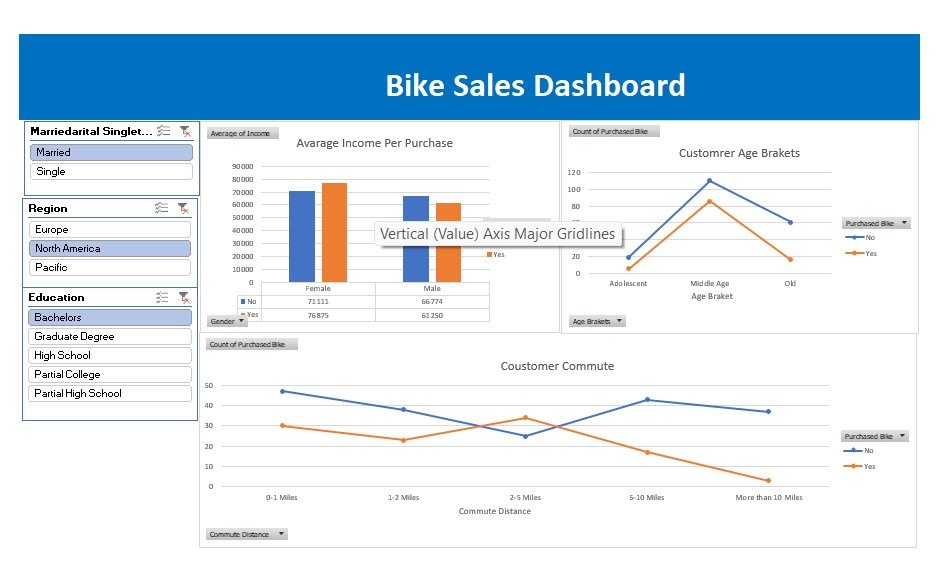

# Bike Buyers – Excel Dashboard

An Excel dashboard that analyzes 1,000 customer records to understand who buys bikes.

## Objective
To find which customer groups (age, region, commute distance, marital status,
income) are more likely to buy a bike.

## Dataset
- Bike Buyers dataset: 1,026 raw rows and 13 columns
- 26 duplicate records removed, leaving 1,000 rows
- Columns: ID, marital status, gender, income, children, education, occupation,
  home owner, cars, commute distance, region, age, purchased bike

## Tools Used
- Microsoft Excel (formulas, pivot tables, charts, slicers)

## What I Did
1. Cleaned the data: removed duplicates and replaced short codes
   (M/F, M/S) with full labels (Male/Female, Married/Single)
2. Created an **Age Bracket** column using an IF formula
   - Under 31: Adolescent
   - 31 to 53: Middle Age
   - 54 and above: Old
3. Built pivot tables for income, commute distance and age bracket
4. Created charts and an interactive dashboard with slicers
   (Education, Marital Status, Region)

## Key Insights
- 48% of customers purchased a bike.
- Middle Age customers buy the most (54%), versus 34% for Old and 35% for Adolescent.
- Customers with a short commute (0-5 miles) buy more than those commuting over 10 miles (30%).
- Pacific has the highest purchase rate (59%), and North America the lowest (43%).
- Single customers buy more (54%) than Married customers (43%).

## Skills Demonstrated
Excel | Pivot Tables | Slicers | IF Formulas | Data Cleaning | Data Visualization | Dashboard Design

## Files
| File | Description |
|---|---|
| `bike-buyers-excel-dashboard.xlsx` | Raw data, cleaned sheet, pivot tables and dashboard |
| `dashboard.png` | Dashboard screenshot |

## How to Use
1. Download `bike-buyers-excel-dashboard.xlsx`.
2. Open it in Microsoft Excel.
3. Go to the **Dashboard** sheet and use the slicers to filter by Education,
   Marital Status or Region.

## Author
**Sikandar Khan**, aspiring Data Analyst, India

🔗 [LinkedIn](https://www.linkedin.com/in/sikandar-khan-5ba465422/)
💻 [GitHub](https://github.com/sikandar-data-analyst)
📧 sikandarkhankhan980@gmail.com
